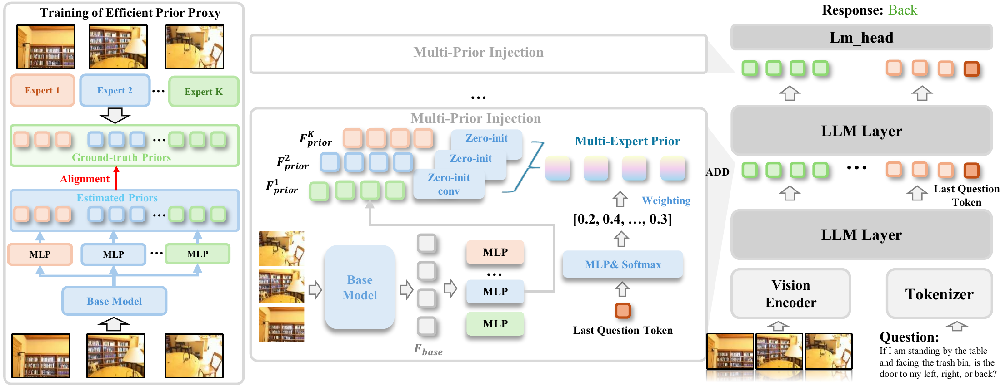

<div align="center">

<h1>Beyond Single Expert: Harmonizing Diverse Visual Priors in MLLMs for Spatial Understanding</h1>
<h3>Accepted at NeurIPS 2026</h3>

[](https://arxiv.org/abs/2607.15054)
[](https://visual-ai.github.io/vips/)
[](https://huggingface.co/leeiioolin/ViPS)
[](https://github.com/Visual-AI/ViPS)
[](LICENSE)

**[Visual AI Lab, HKU](https://visual-ai.github.io/)**

Xiao Lin, Xiaohu Huang, Kai Han<sup>†</sup>

The University of Hong Kong · <sup>†</sup>Corresponding author

</div>

<a id="overview"></a>

## 🌈 Overview

**ViPS improves spatial understanding in MLLMs by bringing together complementary visual priors from multiple expert models.**

<p align="center">
  <a href="assets/method.pdf">
    
  </a>
</p>

- **Efficient Prior Proxy** estimates priors from VGGT, DepthAnything3, TraceAnything, RADIO, and Wan2.1 with one shared backbone.
- **Dynamic Prior Fusion** selects and injects these priors according to the input question.

**Code**

✅ [ViPS Training (Qwen3-VL-8B)](#training)  
✅ [VSI-Bench Evaluation](#evaluation)

**Checkpoints**

✅ [ViPS (Qwen3-VL-8B)](https://huggingface.co/leeiioolin/ViPS/tree/main/vips)  
✅ [Prior Proxy](https://huggingface.co/leeiioolin/ViPS/blob/main/vggt_multihead.pt)

<a id="results"></a>

## 🏆 Results on VSI-Bench

| Model | Obj. Count | Abs. Dist. | Obj. Size | Room Size | Rel. Dist. | Rel. Dir. | Route Plan | Appr. Order | Overall |
|:--|--:|--:|--:|--:|--:|--:|--:|--:|--:|
| [VG-LLM](https://arxiv.org/html/2607.15054v1#S3.T1) | 67.2 | 38.0 | 59.3 | 63.2 | 47.0 | 43.9 | 33.0 | 49.4 | 50.1 |
| [3DRS](https://arxiv.org/html/2607.15054v1#S3.T1) | 68.7 | 34.8 | 53.6 | 56.6 | 40.9 | 43.2 | 30.4 | 39.2 | 45.9 |
| [Vega-3D](https://arxiv.org/html/2607.15054v1#S3.T1) | 69.7 | 35.9 | 58.0 | 60.8 | 45.1 | 43.1 | 30.9 | **60.5** | 50.5 |
| [VLM-3R](https://arxiv.org/html/2607.15054v1#S3.T1) | **70.2** | 49.4 | 69.2 | 67.1 | **65.4** | 80.5 | 45.4 | 40.1 | 57.2 |
| [ViPS](https://huggingface.co/leeiioolin/ViPS#evaluation-of-the-vips-checkpoint) | 69.6 | **54.7** | **71.1** | **72.5** | 60.1 | **81.9** | **45.9** | 53.6 | **63.7** |

<a id="environment-setup"></a>

## 💪 Environment

Tested with **Python 3.10, CUDA 12.8, and PyTorch 2.8.0**.

```bash
# Run from the repository root.
conda create -n vips python=3.10 -y
conda activate vips
conda install -c conda-forge ffmpeg=8.0

python -m pip install --upgrade pip setuptools wheel packaging ninja
python -m pip install torch==2.8.0 torchvision==0.23.0 \
  --index-url https://download.pytorch.org/whl/cu128
python -m pip install -r requirements.txt
python -m pip install --no-deps -e .
MAX_JOBS=4 python -m pip install flash-attn==2.8.3 --no-build-isolation
```

<a id="data-preparation"></a>

## 📚 Data Preparation

**Training:** We follow [VLM-3R](https://arxiv.org/abs/2505.20279) and use its [VSI-Bench training data](https://huggingface.co/datasets/Journey9ni/VLM-3R-DATA/tree/main/vsibench_train).

Download the original RGB recordings from the official sources:

- [ScanNet](https://github.com/ScanNet/ScanNet#scannet-data)
- [ScanNet++](https://scannetpp.mlsg.cit.tum.de/scannetpp/documentation)
- [ARKitScenes](https://github.com/apple-aiml-research/ARKitScenes/blob/main/DATA.md)

**Evaluation:** use the official [VSI-Bench](https://huggingface.co/datasets/nyu-visionx/VSI-Bench) annotations and videos with the bundled LMMS-Eval fork.

Run the preparation commands from the repository root in the `vips` environment.

<a id="training-data"></a>

<details>
<summary>Training data: annotations and video preprocessing</summary>

We use the training data released by [VLM-3R](https://arxiv.org/abs/2505.20279). Prepare the QA annotations and video frames separately using the steps below.

### 1. Download and convert the QA annotations

Download the three files in [Journey9ni/VLM-3R-DATA / vsibench_train](https://huggingface.co/datasets/Journey9ni/VLM-3R-DATA/tree/main/vsibench_train):

- `merged_qa_route_plan_train.json`
- `merged_qa_scannet_train.json`
- `merged_qa_scannetpp_train.json`

Set `VIPS_DATA_ROOT` to a directory on your dataset disk, then download the annotations:

```bash
export VIPS_DATA_ROOT=/path/to/datasets

hf download Journey9ni/VLM-3R-DATA \
  --repo-type dataset \
  --revision aae3535e513d36be5fd0a1edbaab523c8a3c45e4 \
  --include "vsibench_train/*.json" \
  --local-dir "$VIPS_DATA_ROOT/VLM-3R-DATA"

python scripts/prepare_training_annotations.py \
  --input-dir "$VIPS_DATA_ROOT/VLM-3R-DATA/vsibench_train" \
  --output-dir "$VIPS_DATA_ROOT/vips/annotations"
```

The [script](scripts/prepare_training_annotations.py) converts the annotations to JSONL and generates `required_videos.txt`. Link the output directory to `data/train/annotations`:

```bash
mkdir -p data/train
ln -s "$VIPS_DATA_ROOT/vips/annotations" data/train/annotations
```

Prepared training annotations use the following JSONL conversation format:

```json
{
  "video": "<subset>/videos/<scene>.mp4",
  "conversations": [
    {"from": "human", "value": "<video>\n<question>"},
    {"from": "gpt", "value": "<answer>"}
  ]
}
```

### 2. Download the original RGB recordings

Download the full RGB recordings for the scenes listed in `required_videos.txt` using the official instructions:

- **ScanNet:** [download `.sens` recordings](https://github.com/ScanNet/ScanNet#scannet-data).
- **ScanNet++:** [download iPhone `rgb.mkv` recordings](https://scannetpp.mlsg.cit.tum.de/scannetpp/documentation).
- **ARKitScenes:** [download the raw `mov` assets](https://github.com/apple-aiml-research/ARKitScenes/blob/main/DATA.md) from the corresponding `Training` or `Validation` split.

Place the downloads under `$VIPS_DATA_ROOT/raw`:

```text
$VIPS_DATA_ROOT/raw/
├── scannet/scans/<scene>/<scene>.sens
├── scannetpp/data/<scene>/iphone/rgb.mkv
└── arkitscenes/raw/{Training,Validation}/<scene>/<scene>.mov
```

### 3. Resize and sample frames

Uniformly sample **32 RGB frames per video** from the original recordings and resize them to **640×480**:

```bash
python scripts/prepare_training_videos.py \
  --raw-root "$VIPS_DATA_ROOT/raw" \
  --output-dir "$VIPS_DATA_ROOT/vips/videos"

ln -s "$VIPS_DATA_ROOT/vips/videos" data/train/videos
```

The script reads `data/train/annotations/required_videos.txt` by default and saves per-scene JPEGs (`000.jpg`–`031.jpg`) with `video_metadata.json` for training.

</details>

<a id="evaluation-data-official-vsi-bench"></a>

<details>
<summary>Evaluation data: official VSI-Bench</summary>

We evaluate on the official [VSI-Bench](https://huggingface.co/datasets/nyu-visionx/VSI-Bench) dataset. Download and extract the annotations and videos with:

```bash
export VIPS_DATA_ROOT=/path/to/datasets

hf download nyu-visionx/VSI-Bench \
  test.jsonl arkitscenes.zip scannet.zip scannetpp.zip \
  --repo-type dataset \
  --revision d7cb1a3960b79dd3e20d4990b83005e96e1bcd9d \
  --local-dir "$VIPS_DATA_ROOT/VSI-Bench"

mkdir -p "$VIPS_DATA_ROOT/VSI-Bench/videos" data/vsibench
for subset in arkitscenes scannet scannetpp; do
  unzip -n "$VIPS_DATA_ROOT/VSI-Bench/${subset}.zip" \
    -d "$VIPS_DATA_ROOT/VSI-Bench/videos"
done

ln -s "$VIPS_DATA_ROOT/VSI-Bench/test.jsonl" data/vsibench/test.jsonl
ln -s "$VIPS_DATA_ROOT/VSI-Bench/videos" data/vsibench/videos
```

</details>

<a id="pretrained-models"></a>

## 🤗 Pretrained Models

| Model | Download | Local path |
|:--|:--|:--|
| Efficient Prior Proxy | [Proxy checkpoint](https://huggingface.co/leeiioolin/ViPS/blob/main/vggt_multihead.pt) | `checkpoints/vggt_multihead.pt` |
| ViPS | [ViPS weights](https://huggingface.co/leeiioolin/ViPS/tree/main/vips) | `checkpoints/vips/` |
| Base MLLM | [Qwen3-VL-8B-Instruct](https://huggingface.co/Qwen/Qwen3-VL-8B-Instruct) | `models/Qwen3-VL-8B-Instruct/` |

```bash
hf download leeiioolin/ViPS --local-dir checkpoints
hf download Qwen/Qwen3-VL-8B-Instruct --local-dir models/Qwen3-VL-8B-Instruct
```

<a id="directory-layout"></a>

<details>
<summary>Expected directory layout</summary>

```text
vips/
├── models/
│   └── Qwen3-VL-8B-Instruct/
├── checkpoints/
│   ├── vggt_multihead.pt
│   └── vips/
└── data/
    ├── train/
    │   ├── annotations/          # JSONL instruction data
    │   ├── videos/               # 32 pre-extracted frames per scene
    │   └── features/             # Generated by VGGT-MultiHead
    └── vsibench/
        ├── test.jsonl
        ├── videos/               # <dataset>/<scene_name>.mp4
        ├── features/             # Generated by VGGT-MultiHead
        └── cache/
```

</details>

## 🚀 Usage

The ViPS training and evaluation settings are defined in [`configs/vips.yaml`](configs/vips.yaml).

### Core Implementation

ViPS prior fusion is implemented in [modeling_qwen3_vl.py](third_party/transformers/src/transformers/models/qwen3_vl/modeling_qwen3_vl.py):

| Component | Code |
|:--|:--|
| Prior projection and temporal alignment | [ZeroDistillBlockV14](third_party/transformers/src/transformers/models/qwen3_vl/modeling_qwen3_vl.py#L764) |
| Projector and router construction | [Qwen3VLTextModel.__init__](third_party/transformers/src/transformers/models/qwen3_vl/modeling_qwen3_vl.py#L842) |
| Question-conditioned prior fusion | [_zero_distill_inject](third_party/transformers/src/transformers/models/qwen3_vl/modeling_qwen3_vl.py#L1033) |
| Prior injection into decoder layers | [Qwen3VLTextModel.forward](third_party/transformers/src/transformers/models/qwen3_vl/modeling_qwen3_vl.py#L903) |
| Prior inputs during generation | [prepare_inputs_for_generation](third_party/transformers/src/transformers/models/qwen3_vl/modeling_qwen3_vl.py#L1566) |

### Prior Extraction

Use our proxy to extract prior features.

Generate training features:

```bash
bash scripts/extract_features.sh configs/vips.yaml train
```

Generate VSI-Bench evaluation features:

```bash
bash scripts/extract_features.sh configs/vips.yaml vsibench
```

Prior extraction uses one GPU by default. To shard the videos across multiple GPUs:

```bash
VIPS_NUM_GPUS=8 bash scripts/extract_features.sh configs/vips.yaml vsibench
```

### Training

```bash
bash scripts/train.sh configs/vips.yaml --output-dir outputs/train/vips
```

The launcher uses eight GPUs by default. Set `VIPS_NUM_GPUS` to use a different number:

```bash
VIPS_NUM_GPUS=4 bash scripts/train.sh configs/vips.yaml --output-dir outputs/train/vips
```

### Evaluation

Evaluate ViPS on VSI-Bench with LMMS-Eval:

```bash
# Single GPU (default).
bash scripts/eval.sh configs/vips.yaml

# Eight GPUs.
VIPS_NUM_GPUS=8 bash scripts/eval.sh configs/vips.yaml

# Custom checkpoint.
bash scripts/eval.sh configs/vips.yaml --checkpoint /path/to/checkpoint
```

Results are saved to `outputs/eval/vips/`.

## 📌 Citation

If you find ViPS useful in your research, please cite our paper:

```bibtex
@article{lin2026beyond,
  title={Beyond Single Expert: Harmonizing Diverse Visual Priors in MLLMs for Spatial Understanding},
  author={Lin, Xiao and Huang, Xiaohu and Han, Kai},
  journal={arXiv preprint arXiv:2607.15054},
  year={2026}
}
```

## 🌟 Acknowledgements

This project is built upon [Qwen3-VL](https://github.com/QwenLM/Qwen3-VL), [VGGT](https://github.com/facebookresearch/vggt), [Hugging Face Transformers](https://github.com/huggingface/transformers), and [LMMS-Eval](https://github.com/EvolvingLMMs-Lab/lmms-eval). We also thank the authors of DepthAnything3, TraceAnything, RADIO, Wan2.1, and VSI-Bench for making their work publicly available.

## 📄 License

Original ViPS code is released under the [MIT License](LICENSE); third-party code, model weights, and datasets retain their [respective licenses](THIRD_PARTY_NOTICES.md).
